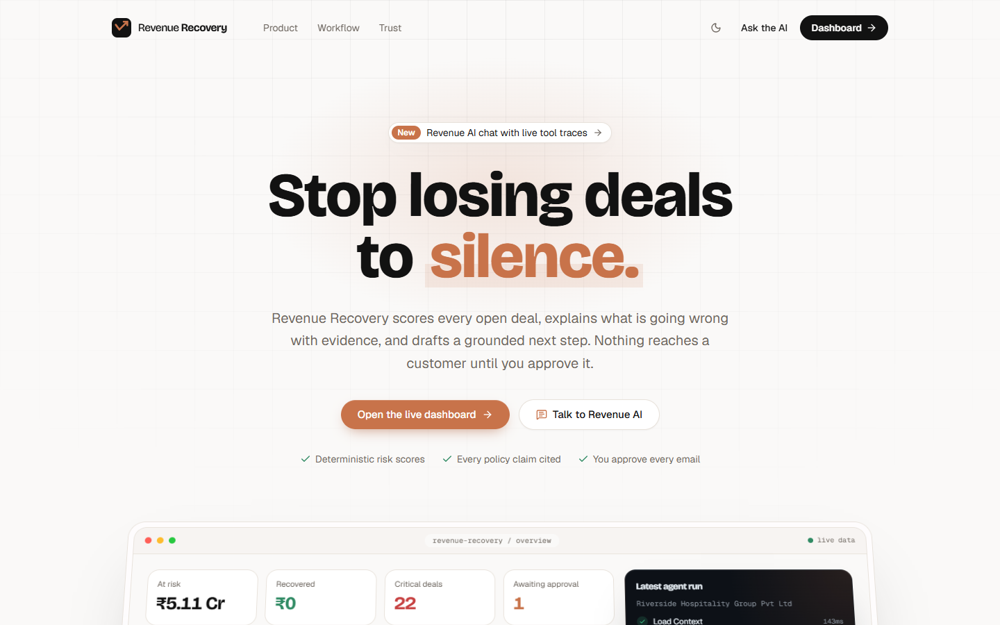
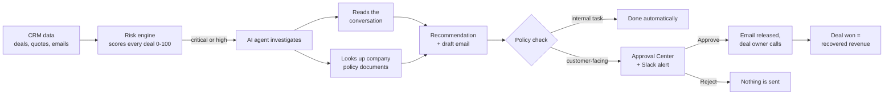
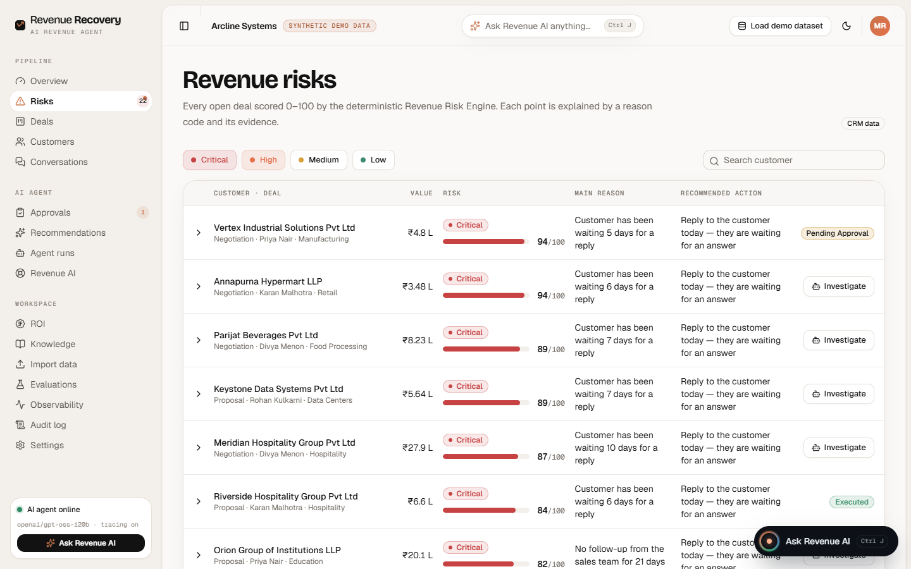
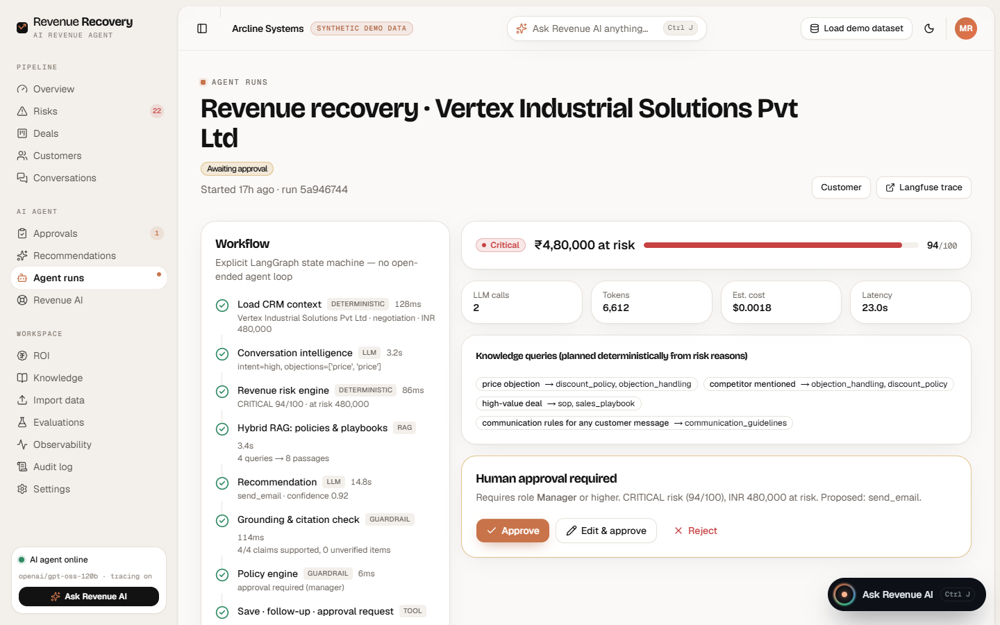
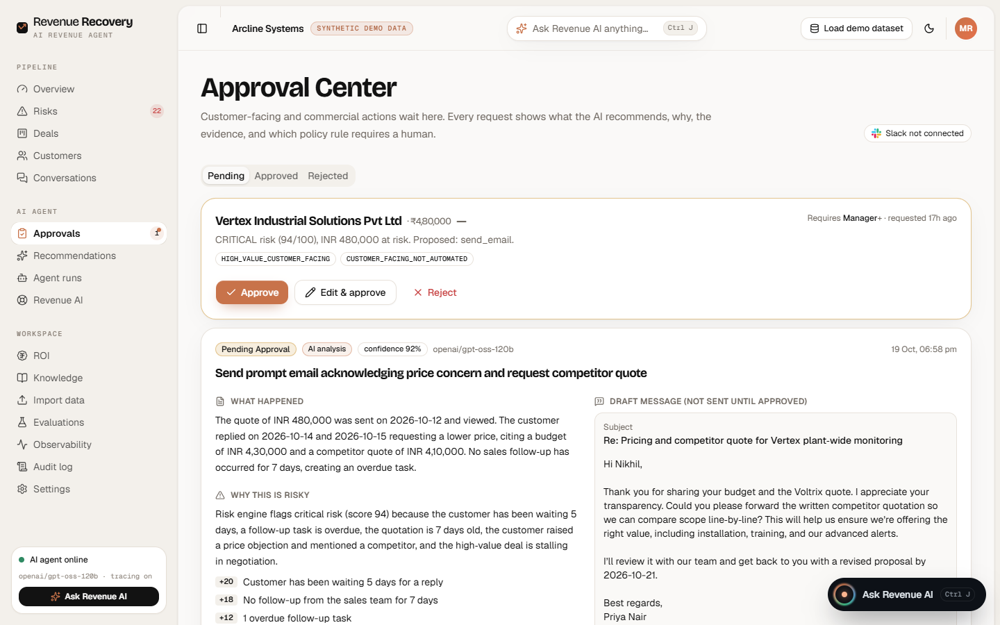
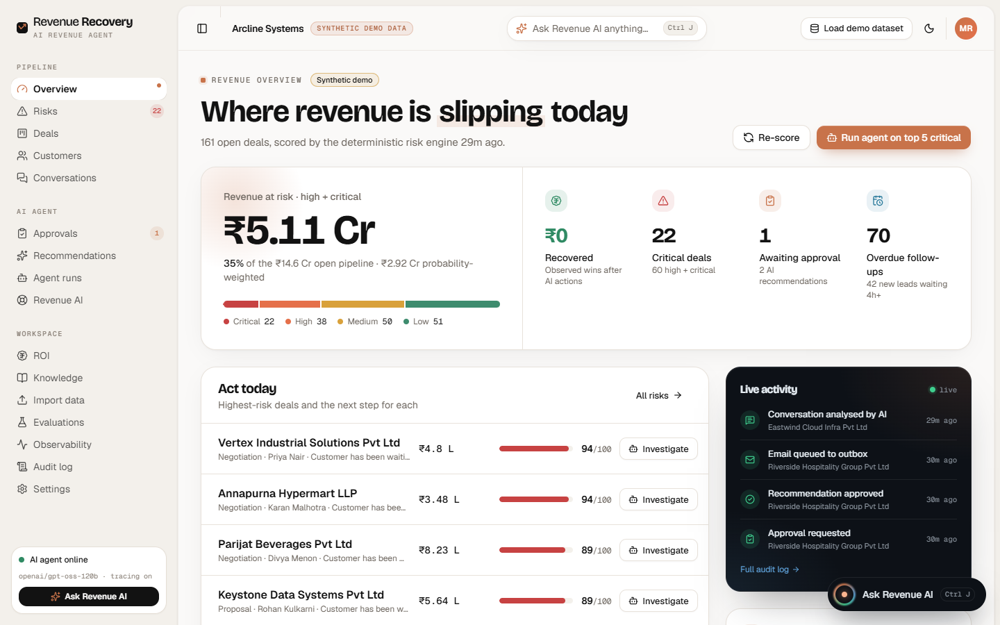
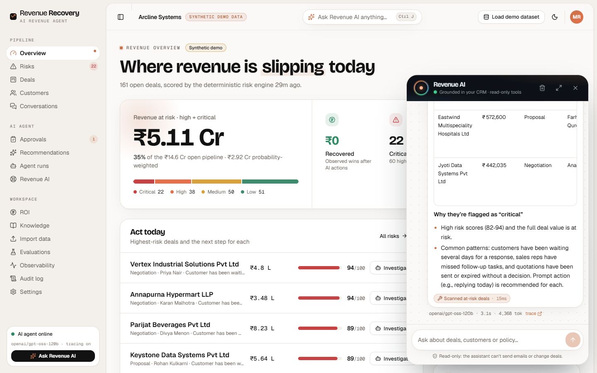

# Revenue Recovery: an AI agent that saves deals before they go quiet

Most B2B deals aren't lost on price. They're lost to **silence**: a customer asks a question, nobody replies for five
days, and they buy from a competitor. Nobody notices until it's too late.

**Revenue Recovery** watches every open deal, spots the ones slipping away, explains why with evidence, drafts the
right follow-up, and **waits for a human to approve it** before anything reaches the customer.



> **All data in this project is synthetic.** The demo company "Arcline Systems", its 340 customers, 270 deals and
> 330 conversations are generated. Nothing here is real customer data.

---

## Contents

1. [How it works: one deal, start to finish](#how-it-works-one-deal-start-to-finish)
2. [What the AI does, and what it doesn't](#what-the-ai-does-and-what-it-doesnt)
3. [A tour of the app](#a-tour-of-the-app)
4. [Tech stack](#tech-stack)
5. [Run it on your machine](#run-it-on-your-machine)
6. [Configuration](#configuration)
7. [How I know it works](#how-i-know-it-works)
8. [Project structure](#project-structure)
9. [Honest limitations](#honest-limitations)
10. [Further reading](#further-reading)

---

## How it works: one deal, start to finish

Here is the real flow, using the demo's main example: **Vertex Industrial Solutions**, a ₹4,80,000 deal.



### 1. The deal goes quiet

Vertex got a quote, replied *"can you do better on the price? Our budget is around ₹4,30,000"*, mentioned that a
competitor (Voltrix) quoted ₹4,10,000, and then nobody from the sales team replied for a week.

### 2. The risk engine flags it: **94/100, Critical**

Every open deal gets a score from fixed, explainable rules. This step uses no AI. Each point has a reason:

| Points | Reason |
|---|---|
| +20 | Customer has been waiting 5 days for a reply |
| +18 | No follow-up from the sales team for 7 days |
| +12 | 1 overdue follow-up task |
| +10 | Quotation sent 7 days ago without a decision |
| +10 | Customer mentioned a competitor |
| … | price objection, high intent but stalled, late stage |



### 3. The AI agent investigates

Click **Investigate** (or "Run agent on top 5 critical"). The agent works through fixed steps you can watch live:

1. **Load** the deal, the customer, the quote and the messages.
2. **Read the conversation** (Groq LLM): high buying intent, price objection, competitor at ₹4,10,000.
3. **Re-score the risk** with what the AI found.
4. **Search the company's policy documents** for what applies here: discount limits, how to handle competitor quotes,
   rules for high-value deals.
5. **Write a recommendation and a draft email**: *"Reply today, acknowledge the budget, ask for the competitor's
   written quote."*
6. **Check every policy claim** against the document it cites. Here, 4 of 4 claims were verified.
7. **Apply company policy**: this is a high-value deal and a customer email, so a **manager must approve**.

A low-risk internal step, such as a follow-up task for the deal owner, is done automatically.



### 4. The sales team is alerted

The recommendation lands in the **Approval Center**. If Slack is connected, the sales channel also gets the deal, why
it is at risk, who to call (with their phone number) and the draft email, with a button to review it.

### 5. A human decides

A manager reads what happened, why it's risky, the evidence and the draft, then chooses **Approve**, **Edit & approve**
or **Reject**. Edits are re-checked against policy: a manager can't raise a discount beyond their authority.



### 6. The action runs, and the result is tracked

On approval, the email is released (and a revised quote is created if a discount was approved), Slack gets a
"✅ approved" message, and the deal owner follows up with a call. If the deal is later won, it counts as **recovered
revenue** on the dashboard and ROI page.

Measured on a live run of this exact deal: **2 LLM calls, ~6,600 tokens, about $0.0018, ~23 seconds.**

---

## What the AI does, and what it doesn't

| Job | Done by | Why |
|---|---|---|
| Risk score (0–100) | **Rules**, not AI | An owner must be able to trust and question the number |
| Understanding customer messages | **AI** (Groq) | Intent, objections and competitors need language understanding |
| Finding the right policy | **Search** (keyword + meaning-based) | So answers come from your documents, not the model's memory |
| Writing the recommendation and email | **AI**, with every policy claim checked | Drafting is where AI saves time |
| Deciding whether a human must approve | **Rules** (policy engine) | Approval rules must never depend on a model |
| Discount maths, revised totals | **Code** | The AI is told never to do arithmetic |
| Sending anything to a customer | **A human**, always | Enforced twice, including inside the email tool itself |

If the AI is unavailable or rate-limited, every AI step falls back to clearly labelled rules and the work goes to a
human. The workflow never silently stops.

---

## A tour of the app

**The dashboard**: money at risk, recovered revenue, the deals to act on today, live activity and quick AI questions.



**Revenue AI chat**: ask in plain English from any page (Ctrl+J). It can only *read* data through tools, shows which
tools it used, and remembers the conversation for follow-up questions.



| Page | What it's for |
|---|---|
| **Overview** | Revenue at risk, recovered revenue, today's priorities, why money is at risk, per-rep breakdown |
| **Risks** | Every open deal with its score and the reasons behind it |
| **Deals / Customers / Conversations** | The CRM view: deal stage and value, customer profile, messages with AI insights |
| **Approvals** | The human-in-the-loop queue: approve, edit or reject the AI's proposals |
| **Recommendations / Agent runs** | Everything the agent suggested, and a step-by-step replay of each investigation |
| **Revenue AI** | Full-screen chat with a panel showing every tool call, its arguments and sources |
| **ROI** | Recovered revenue, labelled *observed*, *estimated* or *synthetic* so nothing is overstated |
| **Knowledge** | The policy documents, search, and grounded Q&A with citations |
| **Import data** | Upload customers, leads and quotes from CSV, with validation and duplicate detection |
| **Evaluations / Observability / Audit log** | Test results, AI cost and speed, and a record of every action |
| **Settings** | Risk thresholds, discount limits, ROI assumptions and Slack alerts |

---

## Tech stack

| Layer | Technology |
|---|---|
| Frontend | Next.js 16 (App Router), TypeScript, Tailwind CSS, shadcn/ui, TanStack Query, Recharts, Motion |
| Backend | FastAPI, Pydantic, SQLAlchemy (async), Alembic |
| AI agent | LangGraph (explicit steps, typed state), Groq (`openai/gpt-oss-120b`) behind a provider interface |
| Search (RAG) | PostgreSQL + pgvector, BM25 keyword search, local ONNX embeddings and reranker (fastembed) |
| Quality | pytest (161 tests), Ragas, a 42-scenario agent evaluation suite |
| Observability | Langfuse traces (every step, token and cost), plus a local usage ledger |
| Integrations | Slack incoming webhook, MCP server exposing `revenue.*` tools |
| Hosting | Vercel (web) · Render (API, Docker) · Neon (Postgres): see [docs/deploy.md](docs/deploy.md) |

---

## Run it on your machine

You need **Python 3.11 with [uv](https://docs.astral.sh/uv/)** and **Node.js 20+**. A
[Groq API key](https://console.groq.com) (free) turns on the real AI; without one, the app still runs and labels its
AI steps as "rules fallback".

### Option A: Docker (one command)

```bash
cp .env.example .env          # then add your GROQ_API_KEY
docker compose up --build     # web → http://localhost:3000 · API → http://localhost:8000/docs
```

The compose file is validated, but this project was developed with Option B (the build machine had no Docker).

### Option B: without Docker

PostgreSQL with pgvector runs embedded from a Python package, so nothing else needs installing.

```bash
cp .env.example .env                                         # add your GROQ_API_KEY
uv sync --project apps/api                                   # backend dependencies
uv run --project apps/api python scripts/dev_db.py start     # local Postgres + pgvector on port 5433
cd apps/api && uv run alembic upgrade head && cd ../..       # create the tables
uv run --project apps/api python -m app.cli load-demo        # load the synthetic demo company

# terminal 1: API
cd apps/api && uv run uvicorn app.main:app --port 8000

# terminal 2: web app
printf 'API_BASE_URL=http://127.0.0.1:8000\nAPI_TOKEN=dev-demo-token-change-me\n' > apps/web/.env.local
cd apps/web && npm install && npm run dev                    # → http://localhost:3000
```

### Try the flow (2 minutes)

1. Open **Overview**: Vertex Industrial is at the top of *Act today* (94/100).
2. Click **Investigate** and watch the agent's steps in **Agent runs**.
3. Open **Approvals**, read the draft email, then **Approve** or **Edit & approve**.
4. Press **Ctrl+J** and ask *"Which deals should I call first today?"*

---

## Configuration

All settings live in `.env` (see [.env.example](.env.example)). Only the database is required.

| Variable | Needed? | What it does |
|---|---|---|
| `DATABASE_URL` | yes | Postgres with pgvector. Local default is the embedded one; Neon/Supabase URLs work as-is |
| `GROQ_API_KEY`, `GROQ_MODEL` | for real AI | Turns on conversation analysis, recommendations and chat |
| `LANGFUSE_PUBLIC_KEY`, `LANGFUSE_SECRET_KEY`, `LANGFUSE_HOST` | optional | Tracing. If tracing fails, the app keeps working |
| `SLACK_WEBHOOK_URL`, `APP_PUBLIC_URL` | optional | Slack alerts for approvals, and where their links point |
| `DEMO_API_TOKEN` | yes (change it) | Shared secret between the web app's server and the API |
| `ACCESS_CODE` (web) | optional | Puts the whole site behind an access code, for private demos |

The API token and all keys stay on the server: the web app calls the API through its own server-side proxy, so
nothing secret reaches the browser.

---

## How I know it works

| Check | Result |
|---|---|
| Automated tests | **161 passing**: unit, integration on a real Postgres + pgvector, and end-to-end through the HTTP API (lead import → risk → agent → approval → execution → recovered revenue) |
| Agent evaluation | **42 / 42 scenarios** pass: approval rules, policy compliance, tool choice and arguments, database effects, failure recovery |
| Policy search | Finds the right policy section for **20 / 20** questions (MRR **0.967**) |
| Prompt-injection test | A deliberately poisoned document is **always withheld** from the model |
| Live agent run | Vertex scenario: 4/4 policy claims verified, routed to a manager, **$0.0018** |

```bash
cd apps/api && uv run pytest -q                       # tests (needs the local database running)
uv run --project apps/api python -m evals.run         # evaluations (live if GROQ_API_KEY is set)
```

The 42 agent scenarios and the retrieval scores above were run **offline**, with a scripted LLM standing in for the
model. They prove the workflow, guardrails and database effects, not the model's writing quality. Live Ragas scores
need a Groq key and are slow on Groq's free tier.

One real bug was only found by the first **live** run: a schema helper silently dropped a field named `title`, so every
real recommendation failed validation. It's fixed and has a regression test, which is why both kinds of testing matter.

---

## Project structure

```
apps/
  api/                     FastAPI backend
    app/
      agents/              LangGraph workflow: investigation + execution graphs
      domain/              risk engine and policy engine (pure, deterministic)
      rag/                 hybrid search, reranking, citation checking
      tools/               typed tools the agent, chat and MCP server share
      integrations/        Slack notifications
      llm/                 provider interface + Groq, structured outputs with retry/fallback
      security/            auth, prompt-injection scanner
      services/            business logic (agent runner, copilot chat, reporting, ingestion)
      mcp/                 MCP server exposing revenue.* tools
    migrations/            Alembic database migrations
    tests/                 unit, integration and end-to-end tests
  web/                     Next.js frontend (landing page, dashboard, chat, all app pages)
data/
  knowledge/               company policy documents (incl. one deliberately poisoned file)
  demo/                    sample CSVs for the import page
evals/                     evaluation datasets, runner and reports
docs/                      architecture, decisions, deployment and more
render.yaml                Render blueprint for the API
docker-compose.yml         Postgres + Redis + API + web
```

---

## Honest limitations

- **Synthetic data.** Risk weights are reasoned defaults, not learned from real won and lost deals.
- **Email isn't really sent.** Approved emails go to an outbox; no email provider is connected yet.
- **No CRM connectors yet** (HubSpot, Salesforce). Data comes from CSV import.
- **Simple auth.** One token-based demo account; production would need SSO and per-user logins.
- **The injection scanner is pattern-based.** It's one layer of defence, not a guarantee.
- **Groq's free tier** (8k tokens/minute) makes back-to-back agent runs slow.

---

## Further reading

| Document | What's inside |
|---|---|
| [Technical overview](docs/technical-overview.md) | The full engineering write-up with architecture diagrams |
| [Architecture](docs/architecture.md) | Components, layers and data flow |
| [Agent workflow](docs/agent-workflow.md) | Every step of the LangGraph agent and its state |
| [RAG](docs/rag.md) | How policy search, reranking and citation checks work |
| [Security](docs/security.md) | Auth, tenant isolation, secrets, prompt-injection defences |
| [Evaluation](docs/evaluation.md) | Test and evaluation methodology |
| [LLMOps](docs/llmops.md) | Tracing, cost tracking, fallbacks |
| [Engineering decisions](docs/engineering-decisions.md) | Why each choice was made, and what was traded off |
| [Deployment](docs/deploy.md) | Vercel + Render + Neon, step by step |
