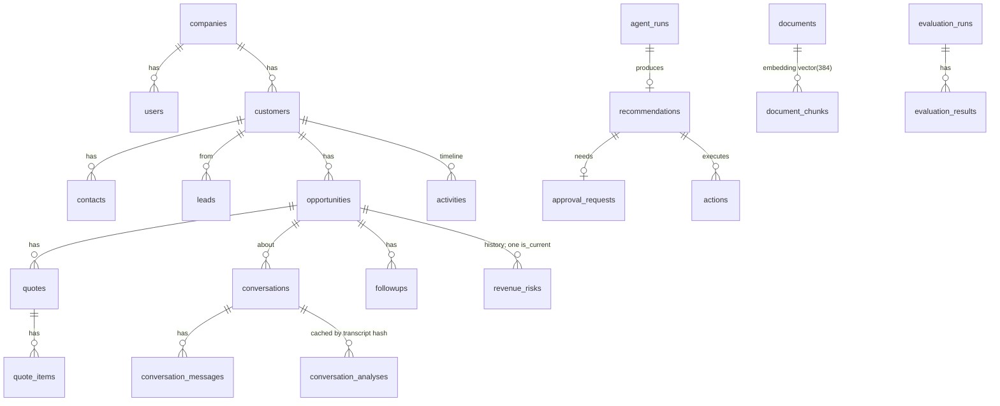

# Architecture

## Monorepo layout

```
apps/
  api/                      FastAPI backend (Python 3.11, uv)
    app/
      core/                 settings, error contract, logging, cache/rate limits
      db/                   SQLAlchemy models (27 tables), async session
      domain/               PURE logic: risk engine, policy engine, settings, heuristics, enums
      llm/                  LLMProvider, GroqProvider, structured output, schema, pricing, usage ledger
      rag/                  chunking, BM25, embeddings/reranker, retriever, grounding, ingestion
      agents/               LangGraph state, nodes, graphs, query planner
      tools/                typed tool contracts + registry (read, write, AI)
      mcp/                  MCP stdio server projected from the tool registry
      prompts/              versioned prompts + output contracts
      services/             orchestration: risk, conversation intelligence, reporting, agent runner, copilot, ingestion
      security/             auth principal, prompt-injection defences
      observability/        Langfuse tracer facade
      evaluation/           sandbox tenant, agent/RAG/copilot evaluators, result store
      demo/                 deterministic synthetic dataset generator
      api/routes/           thin HTTP routers
    migrations/             Alembic
    tests/                  unit · integration · e2e
  web/                      Next.js 16 app router, shadcn/ui, TanStack Query, Recharts
data/knowledge/             policy & playbook documents (synthetic)
data/demo/                  sample CSVs for the import pipeline (with deliberate invalid rows)
evals/                      runner, datasets, reports
scripts/dev_db.py           embedded Postgres + pgvector for local development
docker-compose.yml          postgres(pgvector) · redis · backend · frontend
```

## Layering rules

1. `domain/` imports nothing from FastAPI, SQLAlchemy or the LLM layer. Risk and policy are pure functions that can be
   unit-tested in milliseconds and reasoned about in isolation.
2. Agents never touch the ORM: every read/write goes through a registry tool (validated, traced, audited).
3. Only `llm/groq_provider.py` imports a vendor SDK; everything else depends on `LLMProvider`.
4. Routers are thin: parse, authorise, call a service, return.
5. Every business query filters on `company_id` (tenant isolation is enforced in services and tools, not in the UI).

## Data model (main tables)



Plus `knowledge_sources`, `audit_logs`, `llm_calls`, `ingestion_jobs`, `evaluation_cases`. JSONB is used only for
variable payloads: reason codes, evidence lists, tool I/O, settings, analysis output. Indexes cover tenant + status/time
access paths, a partial unique index guarantees one current risk row per opportunity, and an HNSW index serves vector
search.

## Request paths

- **Read (dashboard):** browser → Next.js proxy (adds token) → router → reporting service → SQL aggregates →
  30-second cache (Redis or in-process), invalidated on writes.
- **Agent run:** `POST /agent/runs` creates an `agent_runs` row (committed), spawns the investigation graph in the
  background; node progress is written through a separate short session so the UI can poll it live; business writes
  commit together at the end.
- **Approval:** `POST /approvals/{id}/decision` → role check → optional edits re-checked by policy → execution graph →
  verification → audit.

## Concurrency and transactions

One `AsyncSession` per request/run (sessions cannot run concurrent queries). Parallelism in retrieval comes from
running the CPU-bound query embedding on a worker thread while BM25 scores in the event loop. The usage ledger and step
progress use their own sessions so they persist even if the main transaction rolls back.

## Local development without Docker

The build machine had no Docker daemon (WSL not installed). `scripts/dev_db.py` runs PostgreSQL with pgvector from the
`pgserver` wheel on port 5433, with separate databases for development and tests. Docker Compose provides the same
topology with `pgvector/pgvector:pg17` and Redis.
