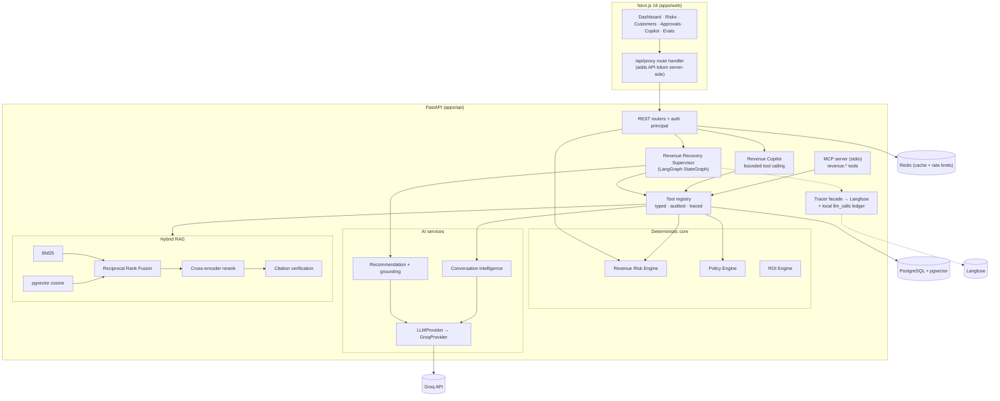
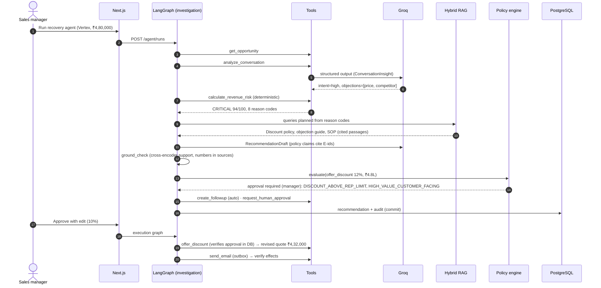

# Technical overview

> The full engineering write-up. For a quick, plain-language introduction start with the [README](../README.md).

> An AI employee that finds, explains, prioritises and helps recover lost revenue before the business owner discovers it.

A full-stack AI revenue-operations product: a deterministic **Revenue Risk Engine** scores every open deal, an
explicit **LangGraph** agent investigates the risky ones (conversation analysis → hybrid RAG over company policy →
grounded recommendation → policy check), and a **human approves** anything customer-facing. Everything is traced in
**Langfuse**, evaluated with **Ragas** and a 42-scenario agent suite, and exposed over **MCP**.

`FastAPI · PostgreSQL + pgvector · LangGraph · Groq · fastembed (ONNX) · Langfuse · Ragas · MCP · Next.js 16 · shadcn/ui`

| | |
|---|---|
| Synthetic demo tenant | 342 customers · 521 leads · 271 opportunities · 211 quotations · 331 conversations · 9 policy documents |
| Tests | 160 passing (unit, integration on real Postgres/pgvector, end-to-end through the HTTP API) |
| Agent evaluation (offline, scripted LLM) | 42 / 42 scenarios — approval, policy and tool-use compliance 1.000 |
| RAG retrieval (offline, no LLM) | hit-rate 1.000 · MRR 0.967 over 20 policy questions |

All data is synthetic. Every number in the UI is labelled *Observed*, *Estimated* or *Synthetic demo*; nothing is
hard-coded and no AI output is pre-generated.

---

## 1. The business problem

Lead arrives → rep calls → quote sent → customer asks a question → rep gets busy → follow-up forgotten → customer
buys from a competitor. Most SMB and mid-market sellers have no single place that answers:

- Which opportunities are at risk, why, and how much money is involved?
- Which quotes are going cold, which customers are waiting on us, who mentioned a competitor?
- Which reps are missing follow-ups?
- What should we do next, what should we say, and what can safely be automated?

## 2. Why it matters

Response time is the strongest predictor of a lost B2B deal. Customers who ask a question and hear nothing for days
rarely say so — they buy elsewhere. The revenue is lost silently; the owner sees it months later as a missed target.

## 3. Product overview

| Page | What it answers |
|---|---|
| **Landing (`/`)** | Product story with live numbers from the demo workspace, a replay of the latest real agent run and an interactive walkthrough of the Vertex scenario |
| **Dashboard (`/dashboard`)** | Revenue at risk, recovered revenue, high-risk deals, overdue follow-ups, AI actions, automation success rate; why revenue is at risk; per-rep discipline |
| **Revenue Risks** | Every open deal scored 0–100 with reason codes, evidence and next step |
| **Customer Intelligence** | Unified profile (value, stage, intent, probability, risk, last contact, objection, competitor, next action) + timeline, quotes, conversations, AI insights, evidence, audit |
| **Conversations** | Transcript + validated LLM analysis (or a clearly labelled keyword heuristic) |
| **Agent Runs** | Live workflow view: each node, its output, latency, tokens, cost and Langfuse trace |
| **Approval Center** | What happened · why risky · evidence · recommendation · what happens if approved · why approval is required → Approve / Edit / Reject |
| **Slack alerts** | When the agent drafts a customer email that needs approval, the sales channel gets the deal, risk reasons, who to call and the draft, with links to review; approvals/rejections are posted back. Optional (`SLACK_WEBHOOK_URL`), best-effort, audited, mrkdwn-escaped |
| **Revenue AI chat** | Floating assistant on every page (`Ctrl/⌘ J`), plus a full-screen view with a tool trace. Multi-turn: the last turns are replayed (bounded, neutralised); every answer comes only from read-only tool calls, which are shown |
| **Knowledge Base** | Policy documents, injection scan results, hybrid-search inspector, grounded Q&A with verified citations |
| **Data Import** | CSV/JSON with row-level validation, de-duplication and entity resolution |
| **Evaluations · Observability · Audit · Settings · ROI** | Measured quality, cost/latency, append-only audit, tunable thresholds, observed vs estimated ROI |

## 4. Architecture



Layering: `domain/` (risk, policy, settings) is pure Python with no I/O; services orchestrate DB + domain; the agent
calls **tools**, never the ORM; routers are thin. Details: [docs/architecture.md](architecture.md).

## 5. Agent workflow



Two graphs with a durable hand-off in Postgres: approvals can take days and must survive restarts. Every transition is
a named edge with a deterministic condition — no open-ended loop. See [docs/agent-workflow.md](agent-workflow.md).

## 6. Data flow

```
CSV / JSON / PDF / Markdown
   → validation (Pydantic, row-level errors) → normalisation (names, emails, ₹4.8L, dates)
   → de-duplication (in-file + DB) → entity resolution (normalised company name, email) → PostgreSQL
   → Revenue Risk Engine (deterministic) → revenue_risks (history kept, one current row per deal)
   → Agent (on demand / batch) → recommendations · approvals · actions · audit_logs
```

## 7. Hybrid RAG

RAG is used **only** for unstructured policy/playbook text. Deals, quotes, dates and money always come from SQL.

- **Lexical:** Okapi BM25 (own implementation; tokeniser keeps `10%`, `₹50,000`, `SVC-AMC`), per-tenant cached index.
- **Dense:** `BAAI/bge-small-en-v1.5` (fastembed, local ONNX, 384-d) in pgvector with an HNSW index, filtered by tenant
  and document type.
- **Fusion:** Reciprocal Rank Fusion (k = 60). **Rerank:** cross-encoder `ms-marco-MiniLM-L-6-v2`, relevance floor 0.2
  → `INSUFFICIENT_EVIDENCE` when nothing qualifies.
- **Grounding:** the LLM must express its answer as claims citing evidence ids. Each claim is verified: cited ids must
  exist, the cited passage must support the claim (cross-encoder ≥ 0.5), and every number in the claim must appear in
  the cited text. Unsupported claims are reported, not kept. Output: `claim · source_document · source_section ·
  retrieval_score · support_score`.

Details and measurements: [docs/rag.md](rag.md).

## 8. Tool calling

Tools are typed contracts (`Tool(name, input_model, output_model, effects, handler)`). The registry validates input,
opens a Langfuse span, runs the handler, validates output, writes an audit row and returns a uniform envelope
(`ok`, `data`, `error`, `provenance`, `limitations`). Failures become a closed error contract
(`code`, `category`, `message`, `retryable`, `remediation`). 21 tools: reads (customer, lead, opportunity, quote,
conversation, history, intelligence, at-risk list, recovery report, sales policy, knowledge search), one LLM tool
(conversation analysis) and writes (follow-up, escalation, activity log, draft, approval request, send email,
offer discount, limited CRM update).

## 9. MCP architecture

`uv run --project apps/api python -m app.mcp` starts a stdio MCP server exposing:

`revenue.get_at_risk_opportunities · revenue.get_customer_intelligence · revenue.search_knowledge ·
revenue.calculate_risk · revenue.create_followup · revenue.request_approval · revenue.get_recovery_report`

Schemas are projected from the same Pydantic contracts; MCP annotations (`readOnlyHint`, `destructiveHint`, …) are
**derived from declared effects**; results carry `untrusted_content` provenance. Customer-facing tools are deliberately
not exposed. A `recover_at_risk_deal` prompt guides clients through an evidence-first workflow. Patterns were inspired
by studying [morluto/rea](https://github.com/morluto/rea) (effect-derived annotations, closed error contract, evidence
and limitations in results, contract invariant tests); no code was copied.

Claude Desktop / any MCP client config:

```json
{ "mcpServers": { "revenue-recovery": {
    "command": "uv", "args": ["run", "--project", "apps/api", "python", "-m", "app.mcp"],
    "cwd": "/path/to/ai-revenue-recovery", "env": { "MCP_API_TOKEN": "dev-demo-token-change-me" } } } }
```

## 10. Human-in-the-loop

The deterministic Policy Engine decides — never the LLM:

| Situation | Outcome |
|---|---|
| Follow-up task, reminder, draft, activity log, escalation | Automatic |
| Any customer email | Approval (sending can be enabled for small deals in Settings) |
| Discount > 10% / > 20% | Manager / Owner |
| Refund (any) / > ₹50,000 | Manager / Owner |
| Customer-facing action on a deal ≥ ₹3,00,000 | Manager |
| AI confidence < 0.7, unverified claims, suspected injection, LLM fallback | Human review |

`send_email` and `offer_discount` re-verify, inside the tool, that an **approved** approval exists in the database —
independent of the graph. Approver edits are re-checked (a manager raising a discount to 25% gets `forbidden`).

## 11. Guardrails

Structured outputs validated by Pydantic (repair by re-ask, then labelled fallback) · verbatim-quote verification of
conversation analysis · claim/citation/number verification · email figures checked against sources · prompt blocks
separated into SYSTEM / USER REQUEST / BUSINESS POLICY / RETRIEVED EVIDENCE / UNTRUSTED CONTENT · injection scanner
flags documents and withholds flagged chunks from the model · read-only tools for the copilot · approval-gated
customer-facing tools · tenant isolation on every query · rate limits on LLM endpoints.

## 12. Evaluation

```bash
uv run --project apps/api python -m evals.run                   # live if GROQ_API_KEY is set, else offline
uv run --project apps/api python -m evals.run --suite agent --mode offline
```

| Suite | Cases | What it measures |
|---|---|---|
| Agent workflow | 42 | workflow completion, risk detection, approval & policy compliance, tool selection & arguments, DB update correctness, hallucination detection, failure recovery |
| RAG | 26 | offline: retrieval hit-rate, MRR, insufficient-evidence, injection withholding · live: + Ragas and citation/policy-fact accuracy |
| Copilot | 12 | live only: tool selection and argument accuracy |

**Measured in this repository (offline mode):**

| Metric | Value |
|---|---|
| Agent: approval compliance / policy compliance / tool selection / DB correctness | 1.000 (n = 39 / 39 / 42 / 40) |
| Agent: failure recovery (timeouts, malformed output, empty KB, closed deal, missing contact) | 1.000 (n = 6) |
| RAG: retrieval hit-rate · MRR | 1.000 · 0.967 (n = 20) |
| RAG: insufficient-evidence at retrieval stage | 0.750 (n = 4) — one unanswerable question retrieves a related passage; the grounded-answer step is the second gate |

Offline agent runs use a scripted LLM: they prove the orchestration, guardrails and database effects, **not** model
quality. Live numbers (Ragas faithfulness, answer relevancy, context precision/recall, copilot tool accuracy) are
produced by running the live suite with a Groq key; until then the app shows **“Not evaluated yet”**.
Reports: `evals/reports/latest_<suite>_<mode>.md`. Details: [docs/evaluation.md](evaluation.md).

## 13. Ragas

Ragas 0.4 metric collections (`Faithfulness`, `AnswerRelevancy`, `ContextPrecision`, `ContextRecall`) run in live mode
with the configured Groq model as judge (OpenAI-compatible endpoint) and local fastembed embeddings. Judge failures are
recorded per case, never silently dropped.

## 14. Langfuse

Set `LANGFUSE_PUBLIC_KEY`, `LANGFUSE_SECRET_KEY`, `LANGFUSE_HOST`. Each run produces a trace:

```
RevenueRecovery (agent)
├── load_context ─ tool:get_opportunity
├── analyze_conversation ─ tool:analyze_conversation ─ conversation_analysis ─ groq:conversation_analysis (generation)
├── assess_risk ─ tool:calculate_revenue_risk
├── retrieve_knowledge ─ tool:search_knowledge_base ×4 ─ hybrid_retrieval ─ bm25 · vector · rerank
├── recommend ─ groq:recommendation (generation: prompt, model, tokens, cost)
├── ground_check · policy_check
└── persist_recommendation ─ tool:draft_followup_message · tool:create_followup · tool:log_action · tool:request_human_approval
RevenueRecovery.execute (after approval, same session) ─ tool:offer_discount · tool:send_email · verify
```

**To inspect:** open Langfuse → *Tracing* → filter by name `RevenueRecovery` (or click *Langfuse trace* on a run) →
expand nodes → click a generation for prompt, model, token usage and cost → click `hybrid_retrieval` for candidates and
reranker scores → use the timeline for per-step latency → scores (`grounding_score`, `recommendation_confidence`,
`eval_*_passed`) are on the trace. Langfuse failures never break a workflow (a unit test runs the whole trace API
against a client that raises on every call). Token/latency/cost also go to the local `llm_calls` table, shown on the
Observability page. Details: [docs/llmops.md](llmops.md).

## 15. Security

Bearer-token authentication resolving to a tenant-scoped principal (OIDC-ready seam) · role checks (rep < manager <
admin < owner) on approvals and settings · tenant filter on every query · SQLAlchemy parameterised queries only ·
upload validation by extension **and** content signature, size caps, no executable formats · API token only on the
Next.js server (proxy) · secrets via environment, never logged or sent to the LLM · append-only audit log ·
prompt-injection defences above. Details: [docs/security.md](security.md).

## 16. Testing

```bash
uv run --project apps/api python scripts/dev_db.py start     # local Postgres + pgvector
cd apps/api && uv run pytest -q                              # 160 tests
```

Unit (risk engine, policy engine, heuristics, BM25/RRF/chunking, injection scanner, claim verification, structured
output repair/fallback, tracing resilience, tool contract invariants) · integration (real Postgres + pgvector, Alembic
migration, real embeddings) · end-to-end through the HTTP API: *import lead → import quote → add conversation with past
timestamps → risk detected → agent → policy retrieved → recommendation → approval → manager edits & approves →
revised quote + outbox email → verification → audit → deal won → recovered revenue attributed.*

## 17. Deployment

**Hosted (private demo):** Vercel for the web app, Render for the API (`render.yaml`), Neon for Postgres + pgvector.
The site sits behind an access code (`ACCESS_CODE`): pages redirect to a "Private demo" screen and API calls are refused
until the visitor enters it. Step-by-step guide: [docs/deploy.md](deploy.md).

**Self-hosted:**

```bash
cp .env.example .env            # add GROQ_API_KEY (and optionally Langfuse keys)
docker compose up --build       # web :3000 · API :8000/docs · Postgres(pgvector) · Redis
```

The API image applies migrations on start and bakes the ONNX models in. *Note: the compose file validates
(`docker compose config`) but the images were not built on the development machine, which had no Docker daemon;
local development used the embedded-Postgres path below.*

## 18. Demo instructions (local, no Docker)

```bash
uv sync --project apps/api --extra eval
uv run --project apps/api python scripts/dev_db.py start
cd apps/api && uv run alembic upgrade head && cd ../..
uv run --project apps/api python -m app.cli load-demo
cd apps/api && uv run uvicorn app.main:app --port 8000          # terminal 1
printf 'API_BASE_URL=http://127.0.0.1:8000
API_TOKEN=dev-demo-token-change-me
' > apps/web/.env.local
cd apps/web && npm install && npm run dev                        # terminal 2 → http://localhost:3000
```

Port 3000 busy? `npm run dev -- -p 3100`. Already have data? Skip `load-demo` and use **Load demo dataset** in the app
header (it also bootstraps an empty database).

**Primary demo — Vertex Industrial Solutions (₹4,80,000):** Day 1 lead · Day 2 call · Day 3 quote · Day 5 asks for a
better price · Day 6 mentions Voltrix Systems at ₹4,10,000 · Day 9 silence.

1. `/dashboard` → *Act today*: Vertex is **CRITICAL 94/100**, ₹4,80,000 at risk.
2. Customer page → risk card lists every reason with its points and source.
3. *Run recovery agent* → watch the workflow: conversation analysis (high intent, price + competitor objections),
   risk engine, 4 policy queries planned from the reasons, recommendation, grounding, policy check.
4. Approval Center → reasons `DISCOUNT_ABOVE_REP_LIMIT` + `HIGH_VALUE_CUSTOMER_FACING`; *Edit & approve* at 10%.
5. Execution: revised quote v2 ₹4,32,000 (computed in code), email recorded in the outbox (not delivered), checks pass.
6. Audit Log and Langfuse show every step. Pipeline → *Mark won* → ROI shows ₹4,80,000 recovered (observed).

Without a Groq key the workflow still runs: the recommendation is produced by labelled deterministic rules and routed to
review. Add `GROQ_API_KEY` + `GROQ_MODEL=openai/gpt-oss-120b` for the full AI path.

## 19. ROI methodology

- **Observed:** opportunities analysed, high-risk count, revenue at risk, agent runs, drafts, follow-ups created,
  actions executed, **recovered revenue = deals won after an executed recovery action on that deal**, estimated LLM cost.
- **Estimated (labelled):** hours saved = runs × review minutes + drafts × drafting minutes + follow-ups × task minutes;
  potential recovery = high/critical revenue at risk × assumed recovery rate. Assumptions are editable in Settings.
- **Synthetic demo:** every figure computed on the demo tenant is labelled as such.

## 20. Limitations

- Synthetic data; risk weights are reasoned defaults, not fitted to a real company's outcomes.
- Purchase probability is a calibrated heuristic (stage base × historical win rate × intent), not a trained model.
- Email is recorded to an outbox; no email provider integration. No CRM connectors (HubSpot/Salesforce) yet.
- Live Ragas / copilot evaluation suites have not been run yet (`python -m evals.run --mode live`); on Groq's free tier
  (8k tokens/min) they are slow. The live agent and chat paths have been exercised manually.
- Auth is token-based with a demo token; production needs OIDC/SSO and secret rotation.
- Docker images were authored but not built on the development machine.
- The injection scanner is pattern-based; it is one layer of defence, not a guarantee.

## 21. Future improvements

CRM connectors (HubSpot, Salesforce, Zoho) with webhook-driven risk updates · learned risk weights from won/lost
outcomes · scheduled nightly risk runs + Slack/email digests · real email/WhatsApp providers with delivery tracking ·
OIDC + per-user API keys · LLM-judge evaluation of draft quality · online evaluation sampled from production traces ·
multilingual conversation analysis.

---

**Docs:** [architecture](architecture.md) · [business problem](business-problem.md) ·
[agent workflow](agent-workflow.md) · [RAG](rag.md) · [evaluation](evaluation.md) ·
[LLMOps](llmops.md) · [security](security.md) · [engineering decisions](engineering-decisions.md) ·
[interview guide](interview-guide.md) · [implementation plan](implementation-plan.md)
